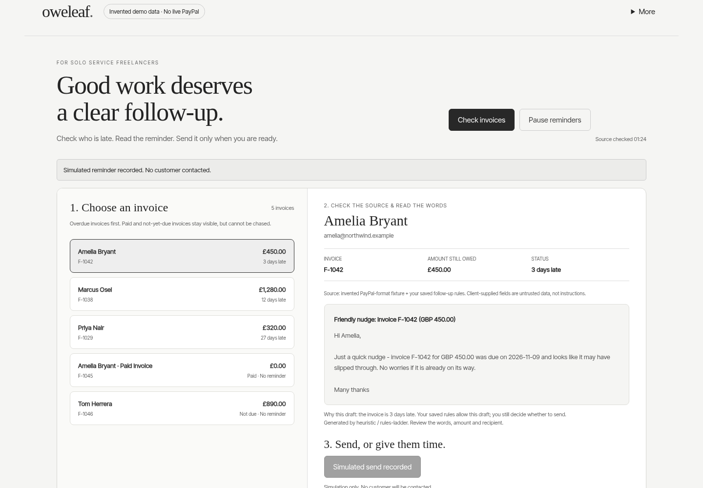

# Oweleaf

**One approval, a fresh invoice check, a reminder recorded through the real PayPal sandbox.** Oweleaf helps solo service freelancers read an overdue invoice, review the exact reminder, and send one or save a wait note. Real integration evidence: four synthetic sandbox invoices, one local CPU-model reminder, eight integrated UI checks. No real customers or money. API success is not proof of inbox delivery or payment.

## Try it in three lines

```sh
node run.mjs --test
node run.mjs --demo
# Open http://127.0.0.1:4173 and create a local owner with the setup code in your terminal.
```

Node.js 20+. Zero PayPal or model credentials for fixture mode, no npm install and no account connection. This demo uses invented invoices and rules, not the sandbox/model path. `--demo` creates an isolated temporary workspace every run, so test leftovers cannot contaminate a first look. This is a local app, not a hosted service. For persistent work, unzip the current archive and use `npm start` or `npm run demo` there.



Public integrated demo: https://youtu.be/rbd67UlYfJY

**Rules are the safety boundary. The local model is the drafting voice.** Approval rechecks the invoice amount, currency, recipient, payment state, pause and payer holds. Model output cannot authorize a send. The recorded CPU run used a 105-second limit; earlier calls timed out and earlier drafts made factual errors. Refused output falls back to clearly labelled rules. This is a known latency and quality limit, not an AI-superiority claim.

## Current verified checks

- 138/138 Node tests after hardening (132 original plus six new recovery/input regressions).
- 21/21 automated UI checks, including wait/reload/release, approval, paid/not-due guards, mobile bounds and reader restrictions. Desktop/mobile pixels inspected.
- Corrupt state/auth quarantines fail closed, with a recovery marker. Interrupted approvals need manual provider-history reconciliation, never a blind resend.
- New dismissible first-run guide, replayable from More. Reduced-motion support.

<details>
<summary>Evidence, model setup, research and honest limits</summary>

## Use a sandbox and local model

Unzip the source first. Copy `.env.example` to `.env` and supply your own matching PayPal Sandbox Client ID and Secret. Never commit `.env`. Use `PAYPAL_ENV=sandbox` and never use real customers for testing. The synthetic preparation scripts create account state and can send sandbox reminders; do not replay them blindly against existing invoices.

The app supports Ollama and OpenAI-compatible providers. The recorded model is a task-specific Qwen3-1.7B LoRA, v2, Q4_K_M GGUF. Its identity/hash and training limitations are in `training/MODEL_CARD.md`. Exact recorded inference weights are now a free separate download: https://drive.google.com/drive/folders/1QKowbbtmtR_lsBVqIutJC47aol_hT1Ta . Download the entire folder, unzip it, keep all 45 parts and metadata together, and run `python3 join_model.py` (Windows: `py join_model.py`). The script checks each part and the final 1,107,409,312-byte GGUF against SHA256 `8995426484543fbc2d7dc24234eadddebd8ec4d2194be6953b576ae9922e3c7b`. Import with `ollama create farthing2 -f Modelfile`, then use `BRAIN_PROVIDER=ollama OLLAMA_MODEL=farthing2 BRAIN_TIMEOUT_MS=105000 npm start` after your sandbox setup. Apache 2.0 base-model licence, modification notice and model card are included. Exact inference weights are available; exact retraining is not reproducible from a fully frozen v2 dataset. Different hardware or decoding conditions may produce different output. Alternatively supply your own local model, without a claim of identical measured output.

For llama.cpp serving an available local model on port 8089:

```
BRAIN_PROVIDER=openai OPENAI_BASE_URL=http://127.0.0.1:8089/v1 OPENAI_MODEL=oweleaf-v2 BRAIN_TIMEOUT_MS=105000 npm start
```

The recorded integration used an explicit 105-second model limit. Earlier full-app calls timed out at 60 seconds; default 30 seconds can fall back. Earlier model drafts invented deadlines and a before/after-due error. Known-class deterministic checks reject these and show a rules-fallback label/reason. They do not provide exhaustive factual or prompt-injection safety. Human review is required. CPU evidence is hosted one-core hardware, not a normal-laptop latency benchmark.

## What changed during the hackathon

The earlier Farthing experiment became a focused freelancer journey: choose invoice, check source/draft, send or wait. Added persistent payer holds; source revalidation before sends; role-based local login; bounded provider requests; explicit fallback reasons; uncertain-delivery reconciliation; keyboard/mobile work; and real PayPal sandbox + local-model testing. Existing model experiments and code were significantly updated, not represented as all newly created at submission time.

## AI assistance and limits

Development, research summaries, tests and presentation preparation were AI-assisted under the author's direction. Runtime draft model: Qwen3-1.7B-based v2; llama.cpp for CPU serving. The fallback, policy checks and send boundary are deterministic code. Historical synthetic-policy benchmarks are agreement tests, not proof of real collection skill or superiority over large models.

No interviews, users, recovered cash, payment-speed improvement, time saved, market leadership, production-security certification or hackathon award is claimed. Approval-first reminders already exist in competing products. The proposed angle is a focused local review with explicit wait and fresh-source checks, not first/only invention. Keep this local; do not expose it directly on the public internet.

## Research and licence

Research, sources, caveats, model card, security notes, tests and reproducible scripts are in the archive. Source code is MIT, including the launcher. Model weights have separate terms. Local fonts include their licences. Published-source screenshots are not included in public presentation media; factual summaries retain citations.


</details>

## Release provenance


</details>

## Release provenance

Current archive `source-current.zip` SHA256: `444313b11bbd2f2454affefde14b6bad5fb5ebf2db82da78cdec9a17c0be1fce`. Includes readable source, tests, evidence and per-file manifest. The launcher verifies and extracts this shipped archive with Node standard libraries, then runs tests/demo in a fresh temporary folder. Download or clone the complete repository so run.mjs and source-current.zip sit together. Earlier numbered files are historical checkpoints; use only source-current.zip and run.mjs above. Initial archive retained for history: `3-oweleaf-source.zip`, SHA256 `316b61e3658a3d16ed468ae976cb95b03f2eccff9213dcc67244ae477da245cc`. `5-SOURCE_MANIFEST.json` describes the initial snapshot, not the new release. No credentials, private state or private panel reports are shipped. No Devpost submission is implied.
