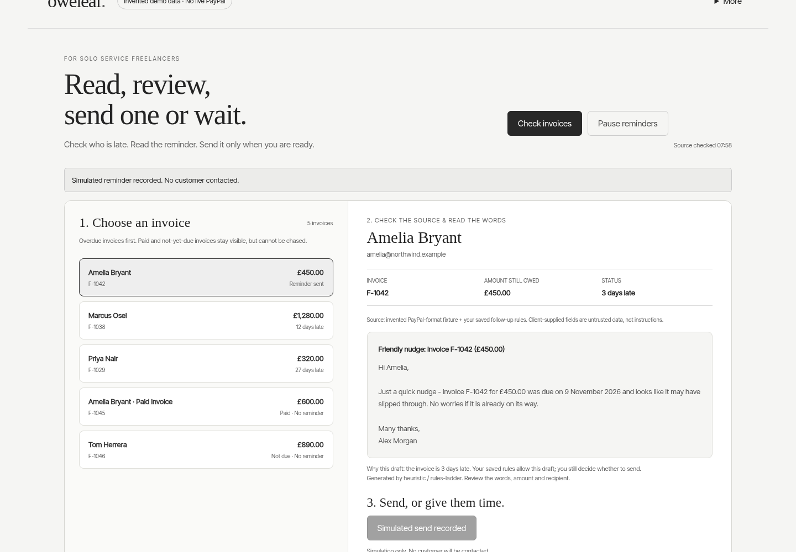

# Oweleaf

**The invoice chaser that knows when not to chase.** Oweleaf reads a freelancer's overdue PayPal invoices, remembers what each client promised, and prepares a follow-up only when a promise is broken. A person approves every send, and PayPal is read again immediately before anything goes out.

- **Live site:** https://oweleaf.vercel.app (the problem, evidence, cost, solution, and a working sample)
- **Working sample:** https://oweleaf.vercel.app/app (invented data, no login, no install)
- **Video (1:57):** https://youtu.be/jNWdOlZoj2U (recorded before the promise feature and the PayPal-wording correction below)

## What is unique

Reminder tools make chasing faster. None of them knows when to hold back. Oweleaf keeps a **promise ledger**: when a client replies "finance will pay Friday", save the date. Reminders to that client stay blocked through Friday. The day after, if PayPal still shows the invoice unpaid, the rules prepare a follow-up that cites the client's own date ("You mentioned payment by 8 November..."). If they paid, nothing happens. This is fixed-rule behaviour, covered by tests, and the model never writes that wording.

- **PayPal:** Sandbox and Live OAuth 2.0 + Invoicing API v2 (list, read, remind). Connect your own keys on the in-app **Connect PayPal** screen without editing files (verified with PayPal before saving, stored encrypted with AES-256-GCM in `src/vault.js`, `LIVE` confirmation required for real accounts, secret never returned to the browser) or via `.env`. The invoice is read again from PayPal immediately before any reminder call; a paid or changed invoice blocks the approval.
- **AI:** a small model on the freelancer's own machine (Qwen3 1.7B through Ollama) does two jobs. It **triages a pasted client reply** against PayPal (`read_reply -> paypal.getInvoice -> decide` in `src/triage.js`): the model classifies what the client said (promise, already paid, needs time, dispute, or other), the app reads PayPal directly, and fixed rules propose the next step and a suggested reply without ever auto-sending. Measured on 20 hand-labelled replies (`node scripts/triage-eval.mjs`, [evals/TRIAGE_EVAL.json](evals/TRIAGE_EVAL.json)): model + rules scored **10/10 dev, 8/10 fresh** (241 ms median, 0 unsafe stop-chasing) vs **9/10 dev, 5/10 fresh** for rules alone. It also **drafts ordinary reminder wording**. Fixed rules compute every date (10/10 in [evals/REPLY_READER_EVAL.json](evals/REPLY_READER_EVAL.json)) and decide whether a send is allowed. See it run: `ollama pull qwen3:1.7b`, then `node run.mjs --demo --ai`. The hosted sample also renders the 3-step reply triage card using Chrome's on-device Prompt API when available, or fixed rules otherwise.
- **MCP (Claude, ChatGPT, any MCP client):** three read-only tools, `todays_plan`, `client_promises` and `draft_for`, over the same decision rules the screen uses. None can send or change anything. Hosted demo over invented invoices: `https://oweleaf.vercel.app/api/mcp`. On real data: `claude mcp add oweleaf -- node src/mcp-server.js` against a running local app.
- **Ask Oweleaf:** a plain-language box in the app ("Who should I chase today?"). Fixed rules write every answer and it refuses to send or approve. When the rules do not recognise a question and a local model is available (`--ai`; in the hosted sample, Chrome's own on-device model if installed), the model only sorts the question into one of five fixed intents and rules answer it. Measured on qwen3:1.7b: 11 of 15 correct on a fresh question set, 14 of 16 on the set the prompt was tuned on, median 90 ms (`node scripts/intent-eval.mjs`, `evals/INTENT_EVAL.json`; small sample, one machine). Wrong picks give a wrong but read-only answer.

## Try it

[Open the browser-only sample](https://oweleaf.vercel.app/app) - invented data, no backend, model or sending. [Rules vs recorded model example](https://oweleaf.vercel.app/comparison.html). The same files are also served at https://vaibhav4046.github.io/oweleaf/ .

```sh
git clone https://github.com/vaibhav4046/oweleaf.git && cd oweleaf
node run.mjs --demo
# Open http://127.0.0.1:4173. No login or credentials needed.
```



Node.js 20+. No npm install. Fresh temporary state on each --demo run, rules-based drafts, no model or PayPal calls. The demo opens on one broken promise (Marcus) and one kept wait (Priya). Without `--ai` no model runs and the screen says so. Persistent/private use: `npm start` after configuration, with local owner authentication. Run `node run.mjs --test` for the full test suite. Source is browsable in `src/`, tests in `test/`, the site and sample in `docs/`, the hosted MCP endpoint in `api/`.

Judge-first replay: [DEMO_SCRIPT_90S.md](DEMO_SCRIPT_90S.md). Simulated agent-as-user checks: run `npm run persona-eval`; results are recorded in [PERSONA_EVALUATION.md](PERSONA_EVALUATION.md). These are test actors, not human research or customer evidence.

## Scale

Each freelancer runs their own copy against their own PayPal account, so there is no shared server to overload. The site, sample and assistant are static files; the hosted MCP endpoint is a stateless function over invented data. Measured on one Windows laptop, fixture mode, read-only requests: 150 concurrent simulated users, 1,800 requests, 0 failures, p95 93 ms ([evals/LOAD_CHECK.json](evals/LOAD_CHECK.json), `node scripts/load-check.mjs`). This says nothing about PayPal's own latency and is not a production capacity claim.

## Current verified checks

- **210/210 Node tests** (`node run.mjs --test`), including encrypted PayPal key vault (`src/vault.js`, `test/vault.test.js`), reply triage (`src/triage.js` + hosted `triage-core.js` parity), pagination, dependency timeouts, recovery, approval safety, authentication, the promise ledger, reply reading, the assistant, and the stdio and hosted MCP servers. Re-verified on Windows 11 / Node 24 on 12 November.
- **UI checks:** 29/29 full-app (`scripts/post-review-ui.mjs`), 26/26 static-sample (`scripts/static-demo-ui.mjs`), 18/18 real-Sandbox Connect PayPal end-to-end UI (`scripts/connect-ui.mjs`), plus interactive hosted reply-triage verification on `docs/app.html` (`Client says paid; PayPal has no payment yet`, 3 steps, zero page errors).
- **Triage eval (`scripts/triage-eval.mjs`, [evals/TRIAGE_EVAL.json](evals/TRIAGE_EVAL.json)):** 10/10 dev, 8/10 fresh with `qwen3:1.7b` (0 unsafe stop-chasing, 241 ms median) vs 9/10 dev, 5/10 fresh for rules alone.
- **Persona eval (`npm run persona-eval`):** 9/9 simulated workflows passing ([PERSONA_EVALUATION.md](PERSONA_EVALUATION.md); test actors, not human evidence).
- **PayPal Sandbox + local model (`node --env-file=.env src/cli-scan.js`):** read 4 synthetic Sandbox invoices through Invoicing API v2, skipped 1 not yet due, proposed 3 reminders (`qwen3:1.7b` produced all 3 drafts with no fallback in 12.7 s on CPU; nothing sent). Earlier recorded sandbox run also completed approval flow on a synthetic invoice.
- New: reversible dismissed drafts, source-bound plain-language copy, visible decision states, paid totals and reactive guide. Also: bounded complete-list reads, explicit fixture/sandbox/live labels, clearer private-account setup. Interrupted approvals never auto-retry; corrupt state/auth fail closed.

**Rules guard the send. The model drafts the words.** A human reviews each reminder, and the app rereads the invoice before sending. Known limit: PayPal's Invoicing v2 specification states that a custom subject and note on the remind call are not honored, so the payer receives PayPal's standard reminder; the draft is your own wording to copy into a personal message. The delivered email text was not checked in a sandbox inbox. The recorded CPU integration allowed 105 seconds; earlier calls timed out or made factual errors. No conclusive AI-superiority or winning-odds claim.

<details>
<summary>Evidence, model setup, research and honest limits</summary>

## Use a sandbox and local model

Copy `.env.example` to `.env` and supply your own matching PayPal Sandbox Client ID and Secret. Never commit `.env`. Use `PAYPAL_ENV=sandbox` and never use real customers for testing. The synthetic preparation scripts create account state and can send sandbox reminders; do not replay them blindly against existing invoices.

The app supports Ollama and OpenAI-compatible providers. The recorded model is a task-specific Qwen3-1.7B LoRA, v2, Q4_K_M GGUF. Its identity/hash and training limitations are in `training/MODEL_CARD.md`. Exact recorded inference weights are now a free separate download: https://drive.google.com/drive/folders/1QKowbbtmtR_lsBVqIutJC47aol_hT1Ta . Download the entire folder, unzip it, keep all 45 parts and metadata together, and run `python3 join_model.py` (Windows: `py join_model.py`). The script checks each part and the final 1,107,409,312-byte GGUF against SHA256 `8995426484543fbc2d7dc24234eadddebd8ec4d2194be6953b576ae9922e3c7b`. Import with `ollama create farthing2 -f Modelfile`, then use `BRAIN_PROVIDER=ollama OLLAMA_MODEL=farthing2 BRAIN_TIMEOUT_MS=105000 npm start` after your sandbox setup. Apache 2.0 base-model licence, modification notice and model card are included. Exact inference weights are available; exact retraining is not reproducible from a fully frozen v2 dataset. Different hardware or decoding conditions may produce different output. Alternatively supply your own local model, without a claim of identical measured output.

For llama.cpp serving an available local model on port 8089:

```
BRAIN_PROVIDER=openai OPENAI_BASE_URL=http://127.0.0.1:8089/v1 OPENAI_MODEL=oweleaf-v2 BRAIN_TIMEOUT_MS=105000 npm start
```

The recorded integration used an explicit 105-second model limit. Earlier full-app calls timed out at 60 seconds; default 30 seconds can fall back. Earlier model drafts invented deadlines and a before/after-due error. Known-class deterministic checks reject these and show a rules-fallback label/reason. They do not provide exhaustive factual or prompt-injection safety. Human review is required. CPU evidence is hosted one-core hardware, not a normal-laptop latency benchmark.

## What changed during the hackathon

The earlier Farthing experiment became a focused freelancer journey: choose invoice, check source/draft, send or wait. Added persistent payer holds; source revalidation before sends; role-based local login; bounded provider requests; explicit fallback reasons; uncertain-delivery reconciliation; keyboard/mobile work; and real PayPal sandbox + local-model testing. Existing model experiments and code were significantly updated, not represented as all newly created at submission time.

## AI assistance and limits

Development, research summaries, tests and presentation preparation were AI-assisted under the author's direction. Runtime draft model: Qwen3-1.7B-based v2; llama.cpp for CPU serving. The fallback, policy checks and send boundary are deterministic code. Historical synthetic-policy benchmarks are agreement tests, not proof of real collection skill or superiority over large models.

No interviews, users, recovered cash, payment-speed improvement, time saved, market leadership, production-security certification or hackathon award is claimed. Approval-first reminders already exist in competing products. The proposed angle is a focused local review with explicit wait and fresh-source checks, not first/only invention. Keep this local; do not expose it directly on the public internet.

## Research and licence

Research, sources, caveats, model card, security notes, tests and reproducible scripts are in the archive. Source code is MIT, including the launcher. Model weights have separate terms. Local fonts include their licences. Published-source screenshots are not included in public presentation media; factual summaries retain citations.


</details>

